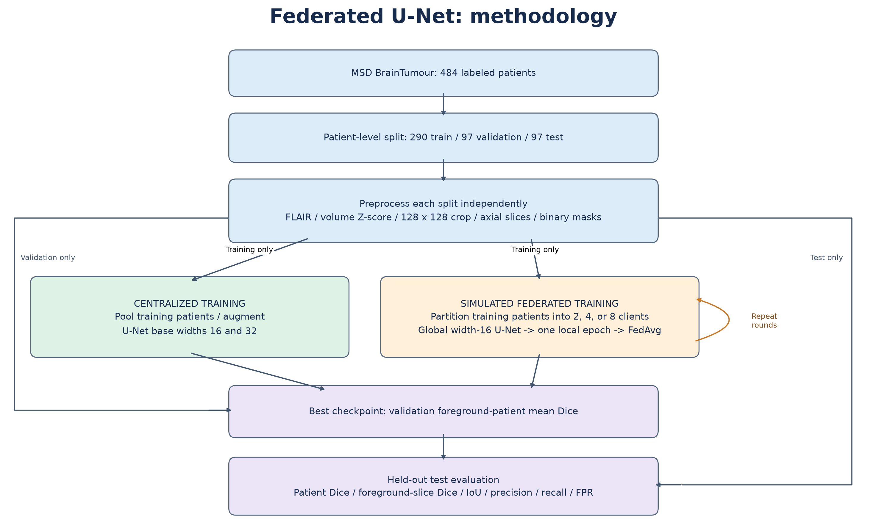
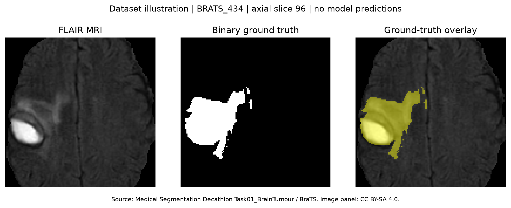
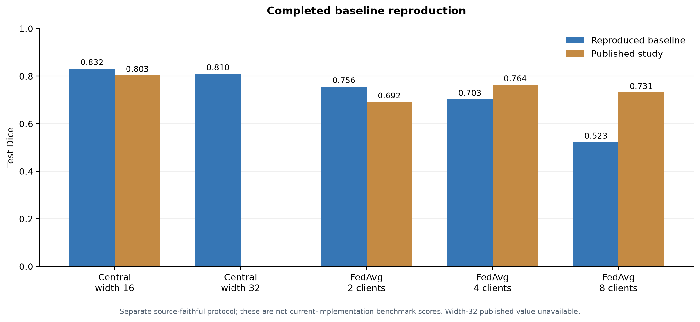

<div align="center">

# Federated U-Net for Brain Tumour Segmentation

**Centralized and simulated federated learning for MRI segmentation**


[Overview](#overview) · [Installation](#installation) · [Dataset](#dataset) · [Experiments](#run-experiments) · [Results](#experimental-results) · [References](REFERENCES.md)

</div>

## Overview

An implementation and evaluation framework for whole-tumour segmentation from FLAIR MRI. A 2-D U-Net is trained centrally or through example-weighted federated averaging (FedAvg), with patient-disjoint splits, explicit foreground metrics, and checkpoint verification.



*Methodology of the current implementation. Federated clients are simulated sequentially; validation selects checkpoints, and the test split is evaluated after selection.*

- **Centralized baselines:** U-Net base widths 16 and 32.
- **Federated configurations:** 2, 4, and 8 clients with a width-16 U-Net.
- **Auditable evaluation:** full-slice coverage, per-patient scores, foreground-slice metrics, and false positive rate.
- **Recorded experiments:** configuration, patient manifests, training histories, model weights, and reload checks.

## Folder structure

```text
.
├── brainseg_fl/             # Data, U-Net, FedAvg, training, and metrics
├── docs/                   # Protocol and experiment reporting guide
├── figures/                # Methodology, dataset example, and result plots
├── results/
│   ├── reproduction/       # Completed baseline reproduction records
│   └── smoke/              # Current implementation verification
├── scripts/                # Reproducible figure generation
├── tests/                  # Data, aggregation, metrics, and checkpoint tests
├── .github/workflows/      # Automated test workflow
├── pyproject.toml
├── requirements.txt
├── REFERENCES.md
└── ATTRIBUTION.md
```

## Installation

Use **Python 3.12**. The pinned environment uses TensorFlow 2.16.2 and legacy Keras 2.16.0.

```bash
git clone https://github.com/kawsarfarooq/federated-unet-brain-tumour.git
cd federated-unet-brain-tumour
python -m venv .venv
source .venv/bin/activate
python -m pip install --upgrade pip
python -m pip install -e .
python -m pip install pytest
```

On Windows PowerShell, activate with `.venv\Scripts\Activate.ps1`. CPU execution is supported on Windows; NVIDIA GPU execution requires Linux with compatible drivers and TensorFlow CUDA dependencies. On Linux, install the matching CUDA dependencies with `python -m pip install 'tensorflow[and-cuda]==2.16.2'` when they are not already available.

## Dataset

Use [Medical Segmentation Decathlon Task01_BrainTumour](https://registry.opendata.aws/msd/). Extract the dataset outside the repository:

```text
/data/Task01_BrainTumour/
├── imagesTr/     # 484 labeled MRI volumes
├── labelsTr/     # Corresponding segmentation masks
└── dataset.json
```

The default seed-42 split contains **290 training, 97 validation, and 97 test patients**. FLAIR is standardized per volume and center-cropped to 128 × 128. Nonzero labels form the binary whole-tumour target; full mode processes every axial slice of the crop. Only training patients are assigned to clients.



*Illustrative training-set slice and ground-truth binary mask. This is a dataset example, not a model prediction.*

Dataset terms and citations are listed in [REFERENCES.md](REFERENCES.md). Medical volumes are not included in this repository.

## Run experiments

### Quick verification on CPU

```bash
python -m brainseg_fl --dataset /data/Task01_BrainTumour --cache /data/brainseg_cache --run-dir runs/smoke --mode smoke --device cpu
```

This checks the pipeline using 4 training, 2 validation, and 2 test patients, 16 selected slices per patient, and two training steps. It verifies execution and saved-checkpoint inference; it is not a trained-model benchmark.

### Complete comparison on one GPU

```bash
python -m brainseg_fl --dataset /data/Task01_BrainTumour --cache /data/brainseg_cache --run-dir runs/full --mode full --device gpu --gpu 0
```

All five configurations execute sequentially on **one selected GPU**. Use an available GPU index or UUID; comma-separated selections are rejected. The default GPU memory cap is 2560 MiB, configurable through `--gpu-memory`.

| Setting | Default |
|---|---|
| Centralized epochs / federated rounds | 10 / 10 |
| Local epochs per client per round | 1 |
| Batch size | 8 |
| Optimizer / learning rate | Adam / 0.0001 |
| Loss | 0.5 binary cross-entropy + 0.5 soft Dice loss |
| Augmentation | Random flips and rotations |
| Checkpoint criterion | Validation foreground-patient mean Dice |
| Early stopping patience | 5 validation checks |

Set `--epochs 30 --rounds 200` for longer budgets. Report actual stopping points and processed examples when comparing configurations. See [the protocol](docs/PROTOCOL.md) for metric definitions and limitations.

### Output artifacts

Each run saves `configuration.json`, `data_manifest.json`, `results.json`, and `learning_curves.png`. Experiment directories contain histories and best/last weights. A fresh model reloads the selected checkpoint and verifies inference agreement.

## Experimental results

### Completed baseline reproduction

All five baseline reproduction configurations completed. These records use a **separate source-faithful protocol**; the values below are not performance measurements of the current `brainseg_fl` implementation.

| Configuration | Reproduced test Dice | Reported test Dice |
|---|---:|---:|
| Centralized, width 16 | 0.8317 | 0.8034 |
| Centralized, width 32 | 0.8099 | — |
| FedAvg, 2 clients | 0.7557 | 0.6915 |
| FedAvg, 4 clients | 0.7028 | 0.7637 |
| FedAvg, 8 clients | 0.5227 | 0.7312 |



Published values were not matched consistently. The validation sampler audit found all-background slices in the baseline federated validation selection. Framework and random-sequence differences also limit exact numerical agreement. See [experiment records](results/README.md), [comparison data](results/reproduction/comparison.json), and [sampler audit](results/reproduction/global_validation_sampler_audit.json).

### Current implementation verification

Seven automated tests passed, and real-data CPU verification completed centralized and two-client training with matching initialization and successful checkpoint reloads. Full benchmark training for this implementation remains pending. Its modified data coverage, loss, and metrics require separately measured results.

## Validation and figures

```bash
python -m pytest -q
python scripts/generate_figures.py
# Optional: regenerate the illustrative data panel locally
python scripts/generate_figures.py --dataset /data/Task01_BrainTumour
```

Tests cover patient isolation, complete batch coverage, aggregation weights, foreground metrics, trainability, and checkpoint reloads. The GitHub Actions workflow runs the same test suite on CPU.

## References and attribution

See [REFERENCES.md](REFERENCES.md) for U-Net, FedAvg, the dataset, and the motivating study, and [ATTRIBUTION.md](ATTRIBUTION.md) for source and license notes. The repository implements established methods; it does not assert a new U-Net architecture or a formal privacy guarantee.
