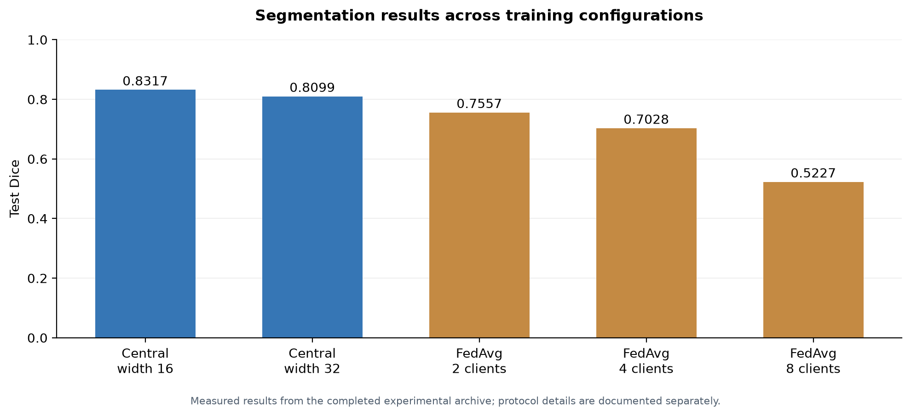
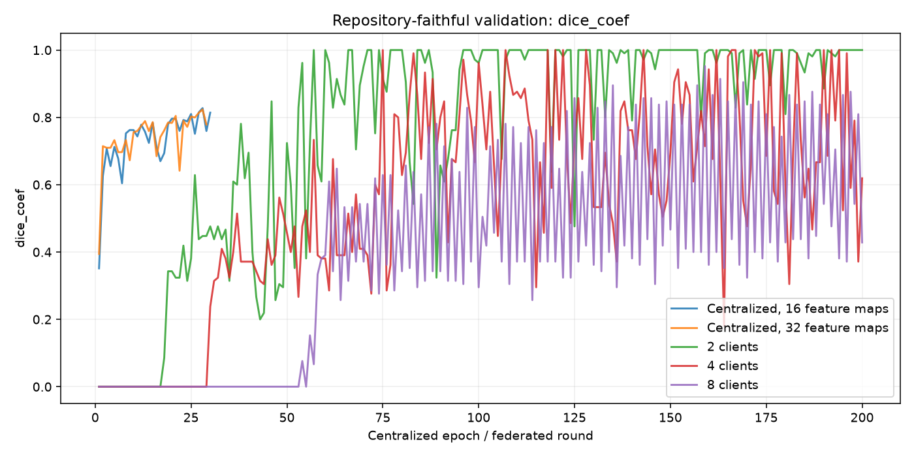
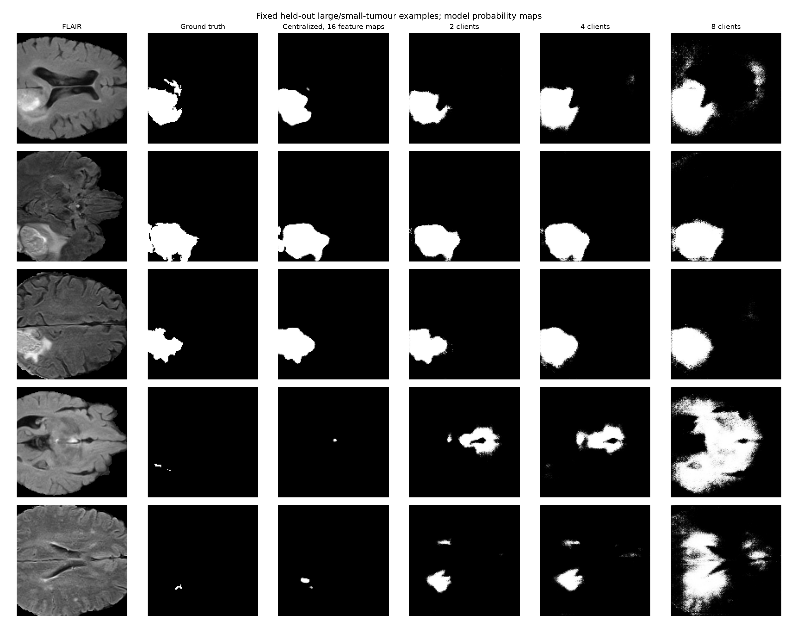

<div align="center">

# Federated U-Net for Brain Tumour Segmentation

**A centralized and federated learning framework for MRI segmentation**

**[Kawsar Farooq (Kasa)](https://github.com/kawsarfarooq)**


[](https://github.com/kawsarfarooq/federated-unet-brain-tumour/actions/workflows/tests.yml)

[Overview](#overview) | [Installation](#installation) | [Dataset](#dataset) | [Experiments](#run-experiments) | [Results](#experimental-results) | [References](#references)

</div>

## Overview

We implement a U-Net framework for whole-tumour segmentation from FLAIR MRI, supporting centralized training and simulated federated learning with FedAvg. Our implementation includes patient-level data partitioning, preprocessing, local client training, model aggregation, checkpoint selection, and segmentation evaluation.


*Complete-slice training and evaluation pipeline: patient-disjoint splits, centralized or federated training, validation-based checkpoint selection, and held-out test evaluation.*

- **Centralized learning:** U-Net models with base widths 16 and 32.
- **Federated learning:** 2, 4, and 8 clients with example-weighted aggregation.
- **Evaluation:** patient Dice, foreground-slice Dice, IoU, precision, recall, and false positive rate.
- **Experiment tracking:** patient manifests, configuration, training histories, model checkpoints, and reload verification.

## Folder structure

```text
.
|-- brainseg_fl/             # Data, network, FedAvg, training, and metrics
|-- docs/                   # Protocol and experiment documentation
|-- figures/                # Methodology, examples, and result plots
|-- results/
|   |-- reproduction/       # Completed experiment archive
|   `-- smoke/              # Pipeline integration checks
|-- scripts/                # Figure generation
|-- tests/                  # Automated validation
|-- .github/workflows/      # Continuous integration
|-- AUTHORS.md
|-- pyproject.toml
`-- requirements.txt
```

## Installation

Use **Python 3.12** with TensorFlow 2.16.2 and legacy Keras 2.16.0.

```bash
git clone https://github.com/kawsarfarooq/federated-unet-brain-tumour.git
cd federated-unet-brain-tumour
python -m venv .venv
source .venv/bin/activate
python -m pip install --upgrade pip
python -m pip install -e .
python -m pip install pytest
```

On Windows PowerShell, activate with `.venv\Scripts\Activate.ps1`. CPU execution supports Windows and Linux. NVIDIA GPU execution requires Linux, compatible drivers, and TensorFlow CUDA dependencies. If needed, install those dependencies with:

```bash
python -m pip install 'tensorflow[and-cuda]==2.16.2'
```

## Dataset

We use [Medical Segmentation Decathlon Task01_BrainTumour](https://registry.opendata.aws/msd/), containing 484 labeled MRI volumes. Extract it outside the repository:

```text
/data/Task01_BrainTumour/
|-- imagesTr/
|-- labelsTr/
`-- dataset.json
```

The complete-slice pipeline uses a seed-42 patient split of **290 training, 97 validation, and 97 test patients**. It selects FLAIR, applies volume-wise Z-score normalization, center-crops to **128 x 128**, and merges nonzero labels into a binary whole-tumour mask. All axial slices of each crop are included in full mode. Training patients are partitioned between federated clients.


*Training-set FLAIR slice, binary ground truth, and ground-truth overlay. Dataset illustration and prediction panels use MSD/BraTS data under CC BY-SA 4.0; see reference 3. Medical volumes are not bundled.*

## Run experiments

### GPU execution

```bash
python -m brainseg_fl --dataset /data/Task01_BrainTumour --cache /data/brainseg_cache --run-dir runs/gpu --mode full --device gpu
```

GPU 0 is selected by default. Use `--gpu INDEX` or `--gpu GPU-UUID` to select a device, and `--gpu-memory` to configure TensorFlow's memory limit.

### CPU execution

```bash
python -m brainseg_fl --dataset /data/Task01_BrainTumour --cache /data/brainseg_cache --run-dir runs/cpu --mode full --device cpu
```

### Quick pipeline check

```bash
python -m brainseg_fl --dataset /data/Task01_BrainTumour --cache /data/brainseg_cache --run-dir runs/check --mode smoke --device cpu
```

Smoke mode uses 4 training, 2 validation, and 2 test patients, 16 selected slices per patient, and two training steps. It checks execution and checkpoint inference rather than model performance.

### Training configuration

| Setting | Default |
|---|---|
| Centralized model widths | 16 and 32 |
| Federated model width / clients | 16 / 2, 4, 8 |
| Centralized epochs / federated rounds | 10 / 10 |
| Local epochs per round | 1 |
| Batch size | 8 |
| Optimizer / learning rate | Adam / 0.0001 |
| Loss | 0.5 binary cross-entropy + 0.5 soft Dice loss |
| Augmentation | Random flips and rotations |
| Checkpoint criterion | Validation foreground-patient mean Dice |
| Early stopping patience | 5 validation checks |

For longer training, set `--epochs 30 --rounds 200`. Record actual stopping points and processed examples alongside scores. Each run saves configuration, a patient manifest, results, learning curves, histories, and best/last checkpoints. Selected checkpoints are reloaded into a fresh model to verify predictions.

## Experimental results

Our completed experimental archive includes **five configurations**: two centralized models and three federated models. All selected checkpoints passed reload verification.

| Configuration | Test Dice |
|---|---:|
| Centralized, width 16 | 0.8317 |
| Centralized, width 32 | 0.8099 |
| FedAvg, 2 clients | 0.7557 |
| FedAvg, 4 clients | 0.7028 |
| FedAvg, 8 clients | 0.5227 |



*Measured scores from the completed experiment archive. These runs use the archived sampling, loss, and evaluation protocol. The executable complete-slice pipeline has a different protocol; [protocol details](docs/PROTOCOL.md#result-provenance) identify which records belong to each workflow.*

### Learning curves



*Recorded validation Dice histories. Centralized epochs and federated rounds have different update schedules. The archived federated validation sampler selected all-background slices; its coverage audit is included with the records.*

### Segmentation examples



*FLAIR, ground truth, and model probability maps from held-out examples in the completed experimental archive. [Figure details](figures/README.md).*

### Validation

- Eleven automated tests cover data isolation, batch coverage, FedAvg weights, foreground metrics, trainability, checkpoint serialization, and CPU/GPU selection.
- All five archived experiments completed with successful checkpoint reload checks.
- Centralized and two-client real-data integration checks passed with shared initialization and verified checkpoint inference.

[Experiment records](results/README.md) | [Completion record](results/reproduction/completion.json) | [Sampler audit](results/reproduction/global_validation_sampler_audit.json) | [Continuous integration](https://github.com/kawsarfarooq/federated-unet-brain-tumour/actions)

## Development

```bash
python -m pytest -q
python scripts/generate_figures.py
# Regenerate the dataset illustration with local data
python scripts/generate_figures.py --dataset /data/Task01_BrainTumour
```

## References

1. O. Ronneberger, P. Fischer, and T. Brox (2015). [U-Net: Convolutional Networks for Biomedical Image Segmentation](https://arxiv.org/abs/1505.04597).
2. H. B. McMahan et al. (2017). [Communication-Efficient Learning of Deep Networks from Decentralized Data](https://proceedings.mlr.press/v54/mcmahan17a.html). AISTATS.
3. A. L. Simpson et al. (2019). [A large annotated medical image dataset for the development and evaluation of segmentation algorithms](https://arxiv.org/abs/1902.09063). [MSD/BraTS data and terms](https://registry.opendata.aws/msd/): CC BY-SA 4.0. Dataset illustrations retain these terms; dependencies retain their respective licenses.
4. J. Stott, H. Bau, and T. L. van Zyl (2023). [Training a U-Net Model for Brain Tumour Segmentation Using Federated Learning](https://github.com/jeremyscodes/Training-a-U-Net-Model-for-Brain-Tumour-Segmentation-Using-Federated-Learning). Related implementation and experimental protocol.
